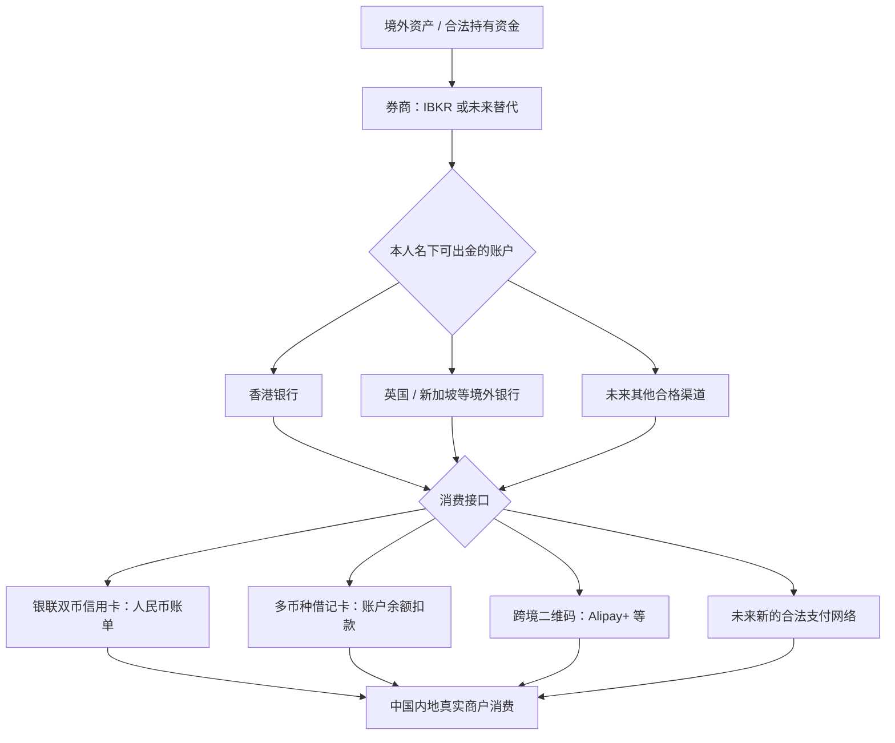

# 境外投资资金 → 中国内地消费：长期开放式规划

> **状态：暂存（PARKED），未来 1–2 年可能启动；现在不开户、不申请信用卡、不转账。**  
> **核心原则：保留接口，不押注单一卡、单一银行或 2026 年活动。**  
> 本文是 2026-11-12 讨论的长期研究笔记和未来执行规范，不是可直接照抄的现行办卡教程。所有产品资格、费用、资金通道、奖励、税务及监管规则在实际执行前必须重新核实。

## 0. 目标与边界

**目标**：对依法持有、来源可解释的境外投资资金，建立一套能够支持中国内地日常消费的跨境支付体系。

- 重点不是“把钱汇回本人内地银行账户”，而是研究：**境外券商 → 本人境外银行/支付账户 → 境内商户消费**。
- 希望避免为了一项优惠开大量卡；优先低维护成本、实际覆盖率、可解释的资金流和冗余。
- 关注小众替代品，但**“小众”不等于“银行风控更弱”**，也不能作为规避审查的理由。
- IBKR 是核心券商参考；历史讨论涉及 iFAST 及新加坡银行出入金通道。**iFAST 的具体法人实体和账户类型须未来重新确认**，不能把英国 iFAST Global Bank 的产品能力直接套用到 iFAST 新加坡或其他平台。
- 本公开仓库不放持仓、余额、流水、证件、账户号、税务居民身份证明等隐私信息。
- 不以任何方式规避资本项目限制、KYC/AML、税务义务、支付平台或券商规定；“资金不回内地个人银行账户”≠“无需申报、无限制”。

## 1. 长期系统架构（用可替换的模块理解，而不是固定路线）



系统应按 **五个独立接口** 评估，不应把“汇丰 Pulse”误认为整套体系：

1. **Brokerage / 出入金**：IBKR 的具体开户实体、币种、同名账户、出金目的地、入金来源限制、银行识别、风控要求。
2. **Bank / 存放与清算**：银行开户资格、跨境转账、FPS/eDDA/SWIFT/本地清算、账户维护、证明材料、币种余额。
3. **FX / 兑换**：美元、港币、人民币（境内 CNY / 离岸 CNH 的实际银行处理方式）的兑换环节、点差与汇率风险。
4. **Spend / 消费**：可用商户、线上线下、银联/卡组织/跨境 QR、人民币记账与还款、退款、争议处理。
5. **Compliance & Resilience / 合规与韧性**：资金来源可解释、真实交易、纳税责任、账户集中风险、冻结/误伤后的替代路径。

原则：**能去掉不必要的中转就去掉；为真正不同的支付场景保留一个备份；不为了“看起来更隐蔽”制造迂回资金路径。**

## 2. 2026 年讨论过的候选方案（都不是最终选型）

| 路线 | 主要功能 | 可取之处 | 尚待验证 / 风险 |
| --- | --- | --- | --- |
| A. IBKR → iFAST Global Bank → Worldwide Scan & Pay → 内地商户 | 境外银行账户直接扫码支付 | 若历史使用的是**英国 iFAST Global Bank** 且同名出金可用，可少开一张卡 | IBKR→iFAST 是否仍可出金；实体与账户资格；Alipay+ 商户覆盖；换汇点差；不能把所有支付宝/微信个人码视为可用 |
| B. IBKR → 香港银行 → **HSBC Pulse** → 内地银联消费 | 港币/人民币双币信用卡 | 内地人民币账单、信用账期、可能的消费权益 | 批卡资格与年费；人民币账单资金如何取得、如何还款；奖励活动期限；汇丰卓越/One 的账户费与降级后持卡政策 |
| C. IBKR → 香港银行 → **银联双币卡（非 Pulse）** | 替代信用卡消费接口 | 产品可横向替换，避免依赖单一发行人 | 可申请资格、信用额度、人民币还款方式、商户覆盖、年费、活动上限 |
| D. IBKR → 香港银行 → **多币种借记卡** → 内地消费 | 余额实时扣款 | 无须申请信用额度；可能有多币种直接扣账 | 实际绑定支付宝/微信/Apple Pay 的兼容性；人民币交易手续费、商户加价、账户余额币种 |
| E. IBKR → 香港银行 → **银联借记卡/云闪付** → 内地消费 | 借记卡 + 银联网络 | 结构简洁，可作为支付冗余 | 开户与绑卡资格、二维码支持的场景、扣款币种及限制 |
| F. 其他司法辖区的银行或新型支付网络 | 保留未来选项 | 避免把 2026 年的产品清单当作 2028 年全貌 | 必须单独确认合法资格、第三方资金传输方式、托管保障、交易及合规要求 |

**2026 年出现过的产品名只作为“搜索起点”**：香港汇丰 Pulse、汇丰 Mastercard Debit、汇丰 One/Premier、中银香港 Go、信银国际 GBA、中银香港银联借记卡、iFAST Worldwide Scan & Pay。将来可增删，不预设赢家。

### 已知的重要区别

- **Pulse ≠ 汇丰卓越理财 Mastercard**：讨论的“先 Premier 体验 → 申请 Pulse → 降为 One”是用户社区常见经验，不是银行承诺可以永久续卡、永久免年费或必定批卡的方案。
- **双币信用卡 ≠ 不需要换汇**：内地人民币消费记人民币子账户，仍要准备人民币还款资金；美元→离岸人民币的汇差可能决定总成本。
- **多币种借记卡 ≠ 每个二维码都能刷**：卡组织、收单网络、跨境钱包的接受范围是三回事。
- **eDDA 入金 ≠ 必然支持以同样形式出金**：IBKR 官方指引主要描述从香港银行向 IBKR 的 eDDA 入金；IBKR→银行的出金路径要以具体账户界面和当前规则单独核对。
- **iFAST Global Bank 英国银行账户 ≠ iFAST 新加坡投资/平台业务**：身份、清算网络、支付产品不能混写。
- **“免手续费” ≠ 零成本**：仍可能有汇率点差、中转行费、银行账户费、卡网络或商户附加费以及机会成本。

## 3. 小众渠道与风控：评估的是“可持续”，不是“宽松”

担忧：某条主流通道使用人数过多，将来可能加强管理、取消优惠、改变准入规则。

合理的处理方式：

- 观察**官方是否允许**本人同名券商↔银行的正常往来，客户服务能否解释业务用途。
- 评估开户政策、居民身份资格、账户用途限制、KYC 文件要求、交易申诉、客服响应，以及政策突变的可迁移性。
- 同名账户、可证明的资金来源、真实零售消费，通常比多跳中转更容易解释。**但无法据此保证不被审查或冻结。**
- 小众银行/卡的样本少，**不能把“没人讨论冻结”当作“冻结概率低”**；若有客观可比的公开数据，再更新判断。
- 仅为正常运营韧性保留一个替代支付接口，不开展多层转账、分拆交易、借用他人账户、异常充值等规避风控操作。

将来要回答的不是“哪家最不查”，而是：
**哪家在合法、真实的券商资金往来 + 境内商户消费场景下，服务最稳定、条款最明确、总成本最低、替代成本可控？**

## 4. 2026-11-12 快照（容易过期，务必复核）

下列是**当时**核查过的官方信息；并不构成 2027/2028 年的现行规则：

| 项目 | 2026 年快照 | 复核入口 |
| --- | --- | --- |
| IBKR 香港 eDDA | 官网介绍可从香港银行以 HKD/CNY 进行入金；不能据此推导为出金功能 | [IBKR eDDA 指南](https://www.ibkrguides.com/brokerportal/transferandpay/edda-deposit.htm) |
| IBKR 出入金 | IBKR 原则上不接受第三方入金；出金目标、费用、持有期、可用银行与开户实体有关 | [IBKR 资金指引](https://www.interactivebrokers.com.hk/en/support/fund-my-account.php) · [其他费用](https://www.interactivebrokers.com.hk/en/pricing/other-fees.php) |
| iFAST 中国内地扫码 | 英国 iFAST Global Bank 2026-07-15 宣布支持中国内地的 Worldwide Scan & Pay；属于跨币种扫码，非所有商户适用 | [iFAST 官方公告](https://www.ifastgb.com/en/personal-banking/article-details/380242/China-Payments-Now-Available-with-Worldwide-Scan--Pay) · [产品 FAQ](https://www.ifastgb.com/en/service/worldwide-scan-and-pay) |
| 汇丰 Pulse | 2026 年有银联双币人民币账单、特定内地 QR/移动支付优惠；免年费及奖励有时限；人民币子账户需独立还款 | [Pulse 官方](https://www.hsbc.com.hk/zh-cn/credit-cards/products/unionpay-dual-currency-diamond/) · [信用卡 FAQ](https://www.hsbc.com.hk/help/faq/credit-cards/) |
| 汇丰 Premier / One | 2026 年新开非 HKID 的 One、Premier 账户存在资产门槛/低额结存费及体验期规则；**降级保卡没有无条件保证** | [Premier](https://www.hsbc.com.hk/accounts/products/premier/) · [One](https://www.hsbc.com.hk/accounts/products/one/) · [收费表](https://www.hsbc.com.hk/fees/) |
| 汇丰多币种借记卡 | 官方称多币种、境外消费无该行手续费；但要检查商户费用与内地钱包绑定支持 | [Mastercard Debit](https://www.hsbc.com.hk/debit-cards/products/mastercard-debit-card/) |
| 其他双币信用卡 | 信银国际 GBA 等产品曾有内地人民币消费优惠，需以届时版本重查 | [CNCBI GBA](https://www.cncbinternational.com/personal/credit-cards/gba-dual-currency-credit-card/en/index.jsp) |
| 中银香港汇款 | “BOC Remittance Plus” 与普通跨境电汇是不同收费项；不能笼统宣称所有中行→中银香港转账免费 | [中银香港收费表](https://www.bochk.com/en/servicecharge.common.html) |
| 境内个人购汇 | 年度便利化额度**不得**用于境外证券投资等尚未开放的资本项目；应核对资金来源与适用身份 | [国家外汇管理局个人购汇申请书](https://www.safe.gov.cn/zhejiang/file/file/20241230/86e5b2b8a64443bb9e60476cf4041de0.pdf) |
| 境外所得纳税 | 有关义务由个人税收居民身份、所得性质和适用税法决定；“资金不回境内账户”不当然免除 | [国家税务总局个人所得税法](https://www.chinatax.gov.cn/chinatax/n810219/n810744/n3752930/n3752974/c3970366/content.html) |

> 社区办卡经验（如 Premier → Pulse → One）可作为“可能性证据”，不可替代银行审批条件、正式条款，也不能用于推定未来不会关户。

## 5. 真正启动时的执行顺序（2027–2028 或更晚）

### 阶段 A：先确认个人合规与账户事实

- [ ] 明确届时的税收居民身份、个人/券商账户所在司法辖区、合法资金来源、可用跨境投资渠道；必要时向有资质的专业人士咨询。
- [ ] 逐一确认 IBKR 的具体开户实体、已经验证的银行账户、出金币种、收款行与限额；不要只根据别人的“IBKR 都能转”判断。
- [ ] 明确此前使用的 iFAST 到底属于哪家法人实体、哪个账户产品；重新测试银行转账许可范围，不预设旧经验永久有效。
- [ ] 整理现有银行账户与消费工具的功能（只记录类型和功能，不上传账户资料）。

### 阶段 B：只选 2–3 条候选路线

- [ ] **最短链路**：现有可用境外银行 → 真实内地商户消费（QR/借记），能不新开卡就不新开。
- [ ] **香港银联路线**：如确有缺口，再比 Pulse、其他银联双币信用卡与银联借记卡。
- [ ] **冗余路线**：支付网络或银行机构不同，且维护成本较低；不是为了把交易藏起来。
- [ ] 对每条候选核查：开户资格、发卡身份条件、年费与存款要求、商户覆盖、在线/线下、人民币账单与还款、退货争议、资金来源资料、银行关闭账户时如何处理。

### 阶段 C：用“总成本+覆盖率”实测，而非只看返现

针对**真实生活消费**记录（不做虚构/循环消费）：

| 指标 | 记录方法 |
| --- | --- |
| 成功支付覆盖率 | 日常餐饮/商超/线上电商/公共交通各自成功率 |
| 全链路汇兑成本 | 起点币种实际减少金额 vs 商户人民币实付额，包含汇差、账户/网络/商户手续费 |
| 年化固定成本 | 银行低额结存费、信用卡年费、为达门槛冻结资金的机会成本 |
| 消费权益 | 仅计入可持续且符合真实习惯的回赠，促销收益另列 |
| 出入金稳定性 | 正式规则、到账时间、人工审核材料、服务沟通 |
| 操作负担 | App 数量、账单/还款管理、客服及异常处理复杂度 |

总成本不要只看“0 手续费”，应当按**实际成交汇率 + 固定费用 - 可实现奖励**核算。无有效测试结果时不作强行排名。

### 阶段 D：形成“主支付 + 备用支付”，再决定开户

- [ ] 先用合法小额**真实**交易核验兼容性和费用，保留汇率、账单、银行通知。
- [ ] 成本和覆盖率达到要求，才考虑长期使用；不为了返现堆卡。
- [ ] 维护独立的账户回访和年度政策核查表；如支持变化则重新评分，不守住过时选择。

## 6. 重新唤醒该任务的触发条件

**计划复盘窗口：2027 年下半年至 2028 年；不需要现在执行。** 以下事件发生时也可提前重启：

- 境外投资账户的合法资金规模与日常消费需求，足以抵消账户/换汇/维护成本；
- 开始高频跨境出行或境内使用境外资金消费；
- iFAST、香港银行、IBKR、银联、Alipay+ 等出现结构性产品变化；
- 个人居住地、身份、税收居民身份、合规要求明显变化。

重启时先更新**第 4 节规则快照**，再决定第 5 节的路线。不要把 2026 年的 1–2 年体验期、返现比例、免年费、开户门槛原样沿用。

## 7. 开放式研究接口 / 后续扩展格式

每次新增候选路径时，复制下面的模板：

```markdown
### 路线名称（日期）
- 供应商/司法辖区/具体产品：
- 所属层：券商｜银行｜FX｜支付｜冗余
- 目标场景：内地线下｜内地线上｜港澳｜跨境转账
- 是否支持同名 IBKR 资金划转：已核实｜待核实｜不支持
- 可用身份/居民/开户要求：
- 入金/出金币种及方式（分别验证）：
- 内地支付入口/实际商户覆盖：
- 扣账币种 / 结算币种 / 信用卡还款币种：
- 显性费用 / 汇率点差 / 年费 / 存款机会成本：
- 资金来源、合规、税务核验要点：
- 退款/冻结/账户退出策略：
- 官方原文 URL：
- 社区实际案例 URL（标记年份与样本局限）：
- 最后核查日期：
- 结论：保留候选｜准备验证｜暂不适用｜已淘汰
```

## 8. 暂时搁置的方案和观点

- **内地发行的兴业行卡 Visa 白金精英版**：主要提供境外旅游/消费权益，对“境外投资资金 → 内地消费”闭环没有关键接口价值；除非未来产品规则改变，不专门为此办理。
- **招行金葵花、兴业寰宇人生等内地汇款/充值工具**：可能覆盖合法跨境资金的某些前段需求，但不能取代境外券商收款与境外卡在境内消费这两层。
- **中行→中银香港→汇丰→IBKR 等大众路径**：仅是历史候选，不是唯一技术路线；先看是否可以同名直连，减少中间节点。
- **“更小众＝风控更低”**：这是待证实的假设；未有可比数据时不得当作结论。

---

**一句话决策准则**：未来选择的是一个**合法、低成本、可替换、可长期维护的“境外投资资产 → 国内日常消费”支付架构**，而不是 2026 年哪张卡最流行。
